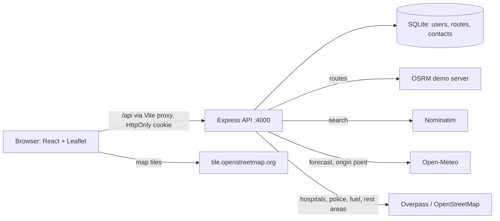

# GoSafe – safety-aware route planner (student prototype)

React + Vite frontend, Node/Express backend, SQLite. **Status: Phase 1 + improvements written (hospital-coverage strip, quick comparison, trip-brief/location sharing, sample journeys, /status system check). Only the scoring unit tests have been run
(in the build sandbox, which had no internet). The API tests, the frontend build and all live provider calls have NOT been run yet;
follow the QA checklist below on your laptop.**

## Architecture


## Run on your laptop (VS Code)
1. Install **Node.js 20 or 22 LTS** from nodejs.org (includes npm). Install VS Code. Check: `node -v` and `npm -v`.
2. VS Code → File → Open Folder → choose the `gosafe` folder. Open a terminal: Terminal → New Terminal.
3. **Backend** (terminal 1), Windows PowerShell:
```powershell
cd backend
npm install
Copy-Item .env.example .env
node -e "console.log(require('crypto').randomBytes(48).toString('hex'))"
```
   Paste the printed text after `JWT_SECRET=` in `backend/.env`, and set `PROVIDER_USER_AGENT` to include your email. Then:
```powershell
npm run db:init
npm run dev
```
   Expected: `GoSafe API listening on http://localhost:4000`.
   macOS/Linux: same, but use `cp .env.example .env`.
4. **Frontend** (terminal 2: click the `+` in the terminal panel):
```powershell
cd frontend
npm install
npm run dev
```
   Expected: `Local: http://localhost:5173/`. Open it in your browser.
5. Register → Plan Route → search a start and destination, pick from results → Compare routes → Dashboard/History shows it.

Ports: frontend 5173, backend 4000. Never commit `.env`. No secrets go in frontend env files.

## Tests
`cd backend; npm test` runs scoring tests (verified to pass in the sandbox) and API tests with fake providers (need `npm install`; not yet run).

## API (all JSON; non-GET requests need header `X-Requested-With: gosafe`; auth = HttpOnly cookie `gosafe_token`)
| Method | Path | Auth | Body / query | Response |
|---|---|---|---|---|
| POST | /api/auth/register | – | `{name,email,password≥8}` | 201 `{user}` + cookie |
| POST | /api/auth/login | – | `{email,password}` | `{user}` + cookie |
| POST | /api/auth/logout | – | – | `{ok:true}` |
| GET | /api/auth/me | yes | – | `{user}` |
| PATCH | /api/profile | yes | `{name}` | `{user}` |
| GET | /api/geocode?q= | yes | q≥2 chars | `{results:[{label,lat,lon}],provenance}` |
| GET | /api/facilities?lat&lon&radius | yes | radius 1000–25000 m | `{facilities:[{id,lat,lon,name,category}],provenance}` |
| POST | /api/routes/plan | yes | `{origin:{label,lat,lon},destination:{…}}` | 201 `{id,routes[],weather,provenance,…}`; 502 if routing provider fails |
| GET | /api/routes?saved=1 | yes | – | `{routes:[summary]}` |
| GET/PATCH/DELETE | /api/routes/:id | yes (owner only, else 404) | PATCH `{saved:boolean}` | route / `{saved}` / `{ok}` |
| GET | /api/status | yes | – | `{checkedAt, providers:[{name,ok,ms,error?}]}` (6/min) |
| GET/POST | /api/contacts | yes | POST `{name,phone}` (max 5) | list / 201 |
| DELETE | /api/contacts/:id | yes | – | `{ok}` |

Errors: `{error, code, details?}` with 400 validation, 401, 403 (CSRF header), 404, 409, 429 (rate limit), 502 (provider).

## Security notes
bcrypt (cost 12) hashes; JWT in HttpOnly, SameSite=Lax cookie (Secure in production), 12 h expiry; CSRF defence = SameSite + CORS allow-list + required custom header; Helmet; auth rate limit (20/15 min); zod validation; parameterised SQL; ownership checks on every route/contact query.

## Data sources and attribution
OSRM public demo server (road geometry/time, no traffic; demo only, not production), Nominatim (≤1 req/s, identifying User-Agent required, results cached 1 h), Open-Meteo (CC BY 4.0, non-commercial free use), Overpass API (shared public server, results cached 10 min). Map data © OpenStreetMap contributors (ODbL). **Please re-check each provider's current usage policy before your demo.** The sandbox had no internet, so endpoints were written from documentation knowledge and are unverified live.

## Troubleshooting
- `JWT_SECRET is missing…`: create `backend/.env` as above.
- `EADDRINUSE`: change `PORT` in backend `.env` and the proxy target in `frontend/vite.config.js`, or close the other program.
- `better-sqlite3` install fails: use Node 20/22 LTS; on Windows you may need to reinstall Node with "tools for native modules".
- Login does nothing / "Cannot reach the server": backend not running, or you opened the backend port instead of 5173.
- 502 / "unavailable": the public provider is slow or rate-limiting; retry. The rest of the app still works.
- Blank map tiles: check internet; OSM tile server may block heavy use.
- Browser console: F12 → Console/Network; look at the failing `/api/...` response body.

## Manual QA checklist
Routes: `/`, `/login`, `/register`, `/about`, `/upcoming`, a bad URL (404), and while logged out `/dashboard`, `/plan`, `/history`, `/emergency`, `/facilities`, `/profile` redirect to login then return after login. Refresh on each page and on `/routes/<id>`. Another user's `/routes/<id>` shows "not found". Register with a short password and bad email (errors shown). Stop the backend (friendly error). Disconnect internet then plan (error, app alive). Deny location permission (message). Empty history and empty contacts show empty states. Keyboard: Tab through nav and forms.

## 2–3 minute demo script
0) Run /status 5 minutes before. 1) Home: tagline. 2) Register/login (data stored in SQLite, password hashed). 3) Plan Route: tap a sample journey (or search two places), show alternatives on the map. 4) Open a route: explain the score badge "PROTOTYPE ESTIMATE", the factor table, the "DATA UNAVAILABLE" rows and the data-sources table. 5) Emergency Mode: warning, location, contacts, nearby hospital/police, "Compare routes here". 6) History shows the saved search. 7) Upcoming page: honest roadmap.

## Limitations
Score weights are assumptions; OSM facilities may be incomplete; weather is a single origin point; OSRM has no live traffic; no accident data; no SOS/calling; no ambulance priority; no password reset/change; no frontend automated tests; in-memory provider cache resets on restart.

## Next steps
1) Run it and fix anything the first run reveals. 2) Phase 2: route-wide weather sampling, password change, frontend tests. 3) Find a verified accident dataset. 4) PWA and multilingual UI.
